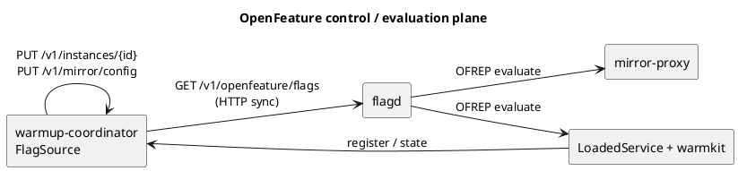

# Архитектура СДПС (DWSS)

## Два контура

| Контур | Компоненты | Ответственность |
|--------|------------|-----------------|
| **DWSS** | warmkit, mirror-proxy, warmup-coordinator, LoadedService, ZooKeeper **или** OpenFeature/flagd | Динамический прогрев нового инстанса production-трафиком |
| **benchmark** | experiment, loadgen, probe, stats, report | Протоколы S0/S_ref/S_dw/H4, статистика, отчёты |

benchmark **не пишет** в store координации. Для S_dw вызывает HTTP API coordinator.

## C4 Container Diagram

```plantuml
@startuml
left to right direction
skinparam shadowing false

title Система динамического прогрева сервисов (СДПС)

actor "Production\nClient" as Client
rectangle "Benchmark Bench" as BenchCont #white;line:dashed {
  rectangle "benchmark" as Bench
}

rectangle "СДПС" {
  rectangle "mirror-proxy" as Proxy
  rectangle "warmup-coordinator" as Coord
  rectangle "Active\nLoadedService" as Active
  rectangle "Warmup\nLoadedService + warmkit" as Warmup
}

database "Coordination store" as Store

Client --> Proxy : production HTTP
Bench --> Proxy : load (эксперимент)
Bench ..> Coord : POST /v1/warmup/sessions
Proxy --> Active : forward
Proxy ..> Warmup : async GET mirror\nX-Warmup-Shadow: 1
Warmup --> Store : instances
Coord --> Store : mirror config (writer)
Proxy --> Store : read mirror + instances
@enduml
```

## Компоненты

### warmkit (`warmkit/`)

Библиотека для инстанса с `ROLE=warmup`:

- Конечный автомат состояний: `«Starting» → «Registered» → «Warming» → «Ready» → «Active» | «Failed»`
- Регистрация инстанса в store координации (ZK ephemeral или OpenFeature-флаг через coordinator)
- Shadow middleware: счётчик GET, запрет мутаций при `X-Warmup-Shadow: 1`
- Readiness handler для `/readyz`

### mirror-proxy (`cmd/mirror-proxy/`)

Контур данных: пересылка на active, асинхронное зеркалирование GET на warmup по текущей конфигурации зеркалирования.

### warmup-coordinator (`cmd/warmup-coordinator/`)

Управляющий контур: единственный writer конфигурации зеркалирования, нарастание доли, перевод в активный режим. При `DWSS_COORDINATION=openfeature` ещё и единственный writer флагов (инстансы регистрируются через HTTP координатора).

### LoadedService (`LoadedService/`)

Имитация нагруженного микросервиса (mmap + lazy index). Роли `active` и `warmup` через env.

### benchmark (`benchmark/`)

Стенд бенчмаркинга: T_first, median, p95, bootstrap CI, manifest.json.

## Координация: ZooKeeper или OpenFeature/flagd

`DWSS_COORDINATION` выбирает backend. Семантика FSM и ramp не меняется.

### ZooKeeper

```
/services/{app}/instances/{instanceId}   # ephemeral, writer: warmkit
/config/{app}/mirror                     # persistent, writer: warmup-coordinator
```

### OpenFeature + flagd

Конфигурация зеркалирования и реестр инстансов — **object flags** в формате flagd. warmup-coordinator — control plane (единственный writer документа). flagd забирает документ по HTTP (`GET /v1/openfeature/flags`, interval 1s) и отдаёт оценку по **OFREP**. mirror-proxy и warmkit читают только через OFREP, без прямых записей в flagd.

```
dwss.{app}.mirror      # object: MirrorConfig (enabled, ratio, target/active ids)
dwss.{app}.instances   # object: map[instanceId]InstanceRecord
```



Ограничение относительно ZK: нет ephemeral znode. Инстанс снимается с флага при `Close()` (остановка процесса). После аварийного kill запись может остаться до следующего PUT с тем же id.

Доля зеркалирования по-прежнему выбирается в proxy (`rand < ratio`), а не через flagd `fractional` targeting — чтобы сценарии H4 оставались сравнимы с ZK.

## Динамический прогрев

1. Coordinator создаёт сессию (`POST /v1/warmup/sessions`).
2. Записывает конфигурацию зеркалирования: `enabled=true`, `ratio=0`, `targetInstanceId`.
3. Каждые `DWSS_COORD_RAMP_INTERVAL_SEC` увеличивает долю зеркалирования по `DWSS_COORD_RAMP_STEPS`.
4. warmkit на warmup при `shadowCount ≥ ReadyAfter` переходит в состояние «Ready», `/readyz=200`.
5. Coordinator переводит `activeInstanceId` на warmup, `ratio=0`.
6. Сессия завершена (`completed`).

## Конфигурация

Все числовые значения — в `.env.local` (gitignored). В коде только имена переменных, без fallback.

См. также: [requirements.md](requirements.md), [warmkit-api.md](warmkit-api.md), [benchmark-methodology.md](benchmark-methodology.md).
